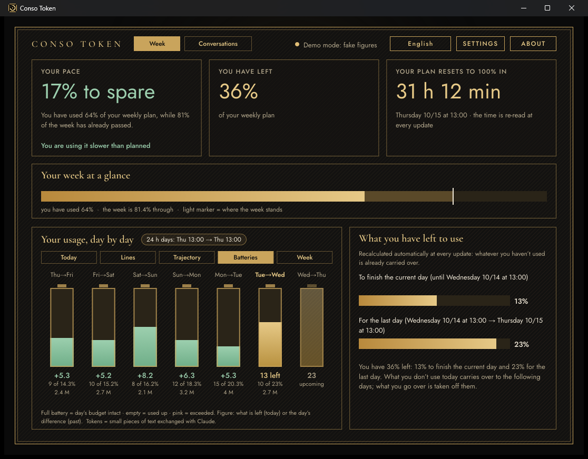
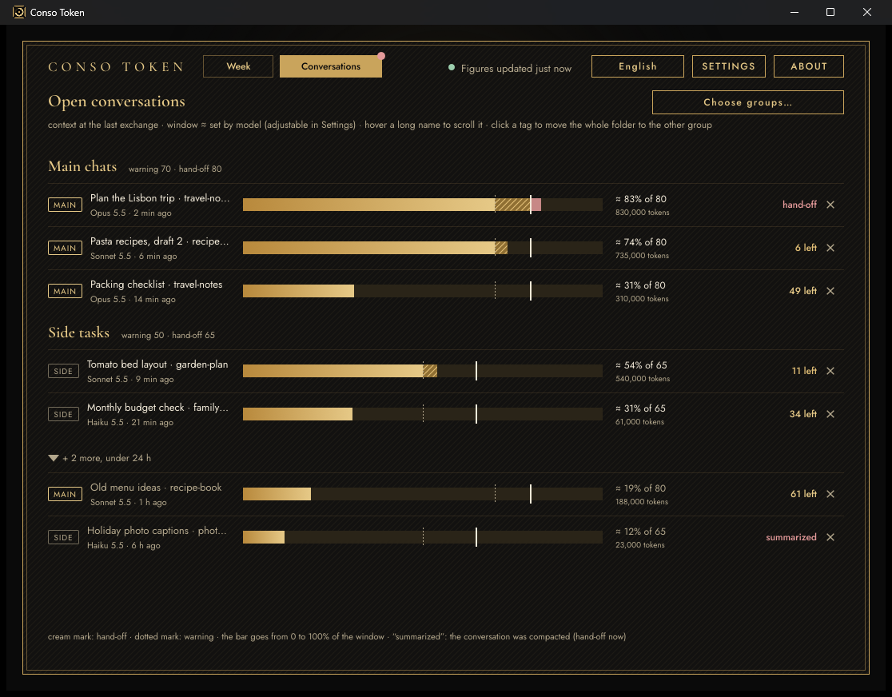
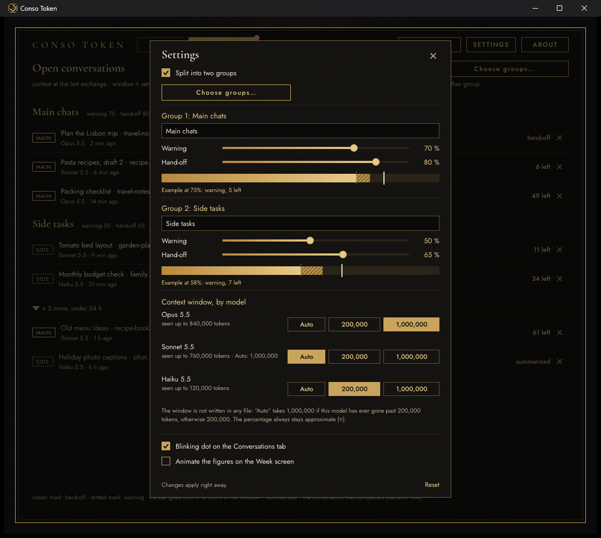

# Conso Token

**Free and open source** · [MIT licence](LICENSE) · Windows 10 and 11 · 8 languages

A small Windows desktop window that shows where you stand on your Claude plan: how much of the week you have used, what you can still use today and on each following day, and whether you are ahead of or over the even pace. It predicts nothing, uses no network and asks for no password.

Since 1.3 a second tab, **Conversations**, shows each Claude Code conversation of the last 24 hours: how full its context is (approximate) and how much is left before it is time to carry on in a fresh conversation. You can split the conversations into two named groups, and hide a conversation with a ✕ (handy for an archived one). The first screenshot below shows the **Week** tab, the second the **Conversations** tab; the SETTINGS window is shown further down, in “How it works”.



The **Conversations** tab, with made-up conversations in two groups: how full the context of each one is, the warning mark (dotted) and the hand-off mark (cream), a ✕ at the right of each row to hide that conversation, and the blinking dot on the tab:



> Independent project, not affiliated with or endorsed by Anthropic. “Claude” belongs to its owner.

**It is free.** Nothing to buy, no account, no subscription. The code is open under the [MIT licence](LICENSE): you may use, copy, modify and share it. The parts it is built with (Slint, two fonts) keep their own licences, listed in [Licences](#licences). The screenshots show demo figures and made-up conversations.

Eight languages: English, Français, Español, Deutsch, Português (BR), Italiano, 中文, 日本語. The program follows the language and the time zone of Windows; a button at the top right changes the language.

## Download

Both files are on the [latest release](../../releases/latest). The checksums (SHA-256) are in the release notes.

| File | Size | What it is |
|---|---|---|
| `conso_token_1.3.4.zip` | 5.6 MB | **The app.** `conso_token.exe` with the one-page guides in eight languages, the setup text and the licences. Unzip the whole `Conso Token` folder, then follow the guide below. |
| `conso_token_presentation.zip` | 15.4 MB | **The presentation and the reading guide** (unchanged since 1.2.1: it does not show the Conversations tab yet). Unzip, then open `index.html` (presentation) or `guide.html` (how to read every number) in a browser. Eight languages, nothing to install, no network. |

The same two pages are in this repository, in [`docs/site/`](docs/site/).

## Install

Unzip the whole `Conso Token` folder of `conso_token_1.3.4.zip` on a drive of your PC, then follow the one-page guide in your language (`README.en.txt` and its translations). About 10 minutes, once: you write one sentence in Claude Code, and Claude sets up a task that sends your figures to the window every 15 minutes.

Needs Windows 10 or 11 and a Claude plan that exposes its usage figures. The program is not signed by a paid publisher, so Windows shows a warning the first time (*More info → Run anyway*).

## How it works

- `conso_token.exe` opens the window.
- `conso_token.exe --pont` receives a small JSON on its standard input (the same format as Claude Code's status line) and stores the plan figures in `%LOCALAPPDATA%\ConsoToken` (`dernier.json` for the last reading, `historique.jsonl` for every change). It is silent. `--pont --suite <command>` forwards the same JSON to a status line already in place.
- The desktop app of Claude cannot call a status line, so a scheduled task of the app (`conso-token-feed`, every 15 minutes) reads the plan usage with the app's own `get_usage` tool and calls [`feeder/envoyer_pont_cache.vbs`](feeder/envoyer_pont_cache.vbs) with four integers (weekly and 5-hour percentages and reset times in Unix seconds; the 5-hour pair can be `- -` for plans that have no 5-hour window). No token is involved.
- A week is `resets_at − 7 days` to `resets_at`, read again at every update, so your own reset day and hour are used. A new week is detected only when `resets_at` moves forward by more than 3 days: the percentage alone proves nothing, because every Claude Code session reports the percentage of *its* last answer.
- A day is a block of 24 h counted from the start of the week. The budget of a day is *what is left at the start of the day ÷ the number of days left (today included)*, so carry-over is automatic. The gap of a day is its budget minus what was used.
- Tokens per day come from the timestamps and the `usage` counters of the Claude Code transcripts (`~/.claude/projects`, or `CLAUDE_CONFIG_DIR`), never from their content. Counted: input + output + cache creation; cache reads are not counted.

- The **Conversations** tab also reads the Claude Code transcripts (the same files), only for the conversations whose last message is less than 24 hours old: the context at Claude's last message (input + cache creation + cache read), the model, the name of the working folder, whether Claude compacted the conversation, and the title of the conversation as the Claude app shows it. Its settings (groups and their names, thresholds, context window by model, hidden conversations) are kept in `conversations.txt` in the data folder; `contextes_vus.txt` keeps the largest context seen for each model (numbers only).
- **What is kept, written and sent.** From the Claude Code files only counters and the title are kept: the title is read in the files already read for the counters, kept in memory while it is displayed, and never written or sent; the text of a message is never kept, written or sent. When you hide a conversation with ✕, the program writes that conversation's session identifier (a plain code, neither its title nor its contents) in `conversations.txt`, so that it stays hidden; it is forgotten once the conversation's last message is more than 24 h old, or as soon as you click “Show again”. Nothing is sent over the Internet.

The **SETTINGS** window (button at the top right of the window): one or two groups with their names and their warning and hand-off thresholds, the context window by model, the blinking dot, the animated figures, “Reset”, and “Show again” when conversations are hidden. The figures in this screenshot are made up:



Options: `--demo` (a made-up week, to see the screen), `--donnees <folder>` (data folder), `--sans-tokens`. Environment variables for tests and screenshots: `CONSO_TOKEN_DATA`, `CONSO_TOKEN_LANGUE`, `CONSO_TOKEN_TZ`, `CONSO_TOKEN_VUE` (0 to 4), `CONSO_TOKEN_DEMO` (`debut`, `milieu`, `hiver`, `mars`), `CONSO_TOKEN_AUTOQUIT` (seconds), `CONSO_TOKEN_APROPOS`.

## Build and test

Rust 1.99 and Slint 1.18.1. Windows only. Keep the build folder **short**: a path of more than 260 characters makes `link.exe` fail (LNK1104).

```
cargo test --workspace --target-dir C:\ct
cargo build --release -p conso_token --target-dir C:\ct
```

`.cargo/config.toml` links the C runtime into the program (`crt-static`), so no Visual C++ redistributable is needed, and fixes the test time zone to `Europe/Paris` and the default language to French (tests that need another language say so).

Layout:

- `noyau/` — pure calculations, no UI: week, budget, gap, carry-over (`modele`), the bridge (`pont`), the transcripts (`transcripts`), time zones (`fr`, `temps`), texts in eight languages (`textes`), the five views (`vues`), the conversations of the last 24 hours (`conversations`, `suivi`) and their settings, hidden conversations included (`reglages`). Tested alone.
- `appli/` — the Slint window (`ui/app.slint`), `src/main.rs`, `src/ecran.rs` (what the screen reads, writes and shows), fonts, icon.
- `feeder/` — the two scripts the scheduled task calls (in a release they live in `outils\`).
- `docs/` — the one-page guides in eight languages, the text Claude follows during setup (`PASTE_INTO_CLAUDE.txt`) and the web pages in `docs/site/`.
- `licences/` — licence texts shipped with the program.

Tips: Slint centres an element without `x`/`y` inside a `Rectangle`: set `x: 0px; y: 0px`. A test that writes files must use `CARGO_TARGET_TMPDIR`, not the system temp folder. The Claude desktop app is a Windows package: programs launched by its tools see a redirected `AppData\Local`, so the setup launches the feeder outside the package (WMI).

## Known limits

The full list is in the [changelog](CHANGELOG.md) (1.3.4). The main ones:

- The size of a context window is in no file, so the percentage is approximate (≈); set the right window by model in SETTINGS if it looks off.
- The Conversations list follows Claude's last message, not the state of the window: an archived or closed conversation stays listed for 24 hours (hide it with ✕), and an open conversation with no message for more than 24 hours does not appear.
- If Claude Code changes its file format the list can be empty **without a warning**.
- **Hidden conversations.** A hidden conversation is forgotten as soon as a reading shows other conversations but not it (normally because its last message is more than 24 hours old; also, rarely, if a project sub-folder cannot be read for a moment: the program ignores that error), and it then comes back in the list. When nothing at all can be read, nothing is forgotten.
- The ✕ of a conversation whose identifier is refused (more than 128 characters, or a control character: Claude's own identifiers have 36 characters) does nothing and says nothing: the identifier is not stored.
- A hand-made `conversations.txt` with thousands of `masquee=` lines slows the window (the duplicates are removed by a comparison that grows with the square of the list: 10,000 lines took about 8 seconds at each reading in a debug build). The program cannot write such a file, because it forgets identifiers at every reading.
- `conversations.txt` is read as UTF-8 and its keys are case-sensitive: a file saved in ANSI (Latin-1 bytes) makes ALL the settings go back to their defaults, hidden conversations included, and the file is replaced at the next change; `MASQUEE=` is ignored.
- No automatic test covers the Slint screens (they were checked by eye), and the translations have not been reviewed by native speakers.
- A build from this repository is not byte-identical to the released `conso_token.exe`: the published program was built with path-remapping flags of the author's machine that `.cargo/config.toml` does not carry, so an exe built from this repository can contain the path of your build folder. The SHA-256 of the released exe is in the release notes.

## Translations

All texts of the program are in one table (`noyau/src/textes.rs`): one line per text, eight cells. The translations have not been reviewed by native speakers yet: corrections are welcome (open an issue or a pull request).

## Licences

MIT for the code, and the licences of the components Conso Token is built with:

- **Conso Token** (this repository): [MIT](LICENSE).
- **Slint** (user interface): “Slint Royalty-free 2.0”. It requires an attribution, which the About screen of the program shows.
- **Cormorant Garamond** and **Jost** (fonts): SIL Open Font License 1.1.
- **serde, serde_json, jiff** and their dependencies: MIT, Apache-2.0 or Unlicense, crate by crate.

The full texts are in [`licences/`](licences/) and the details in [NOTICE.md](NOTICE.md). See also the [changelog](CHANGELOG.md).
